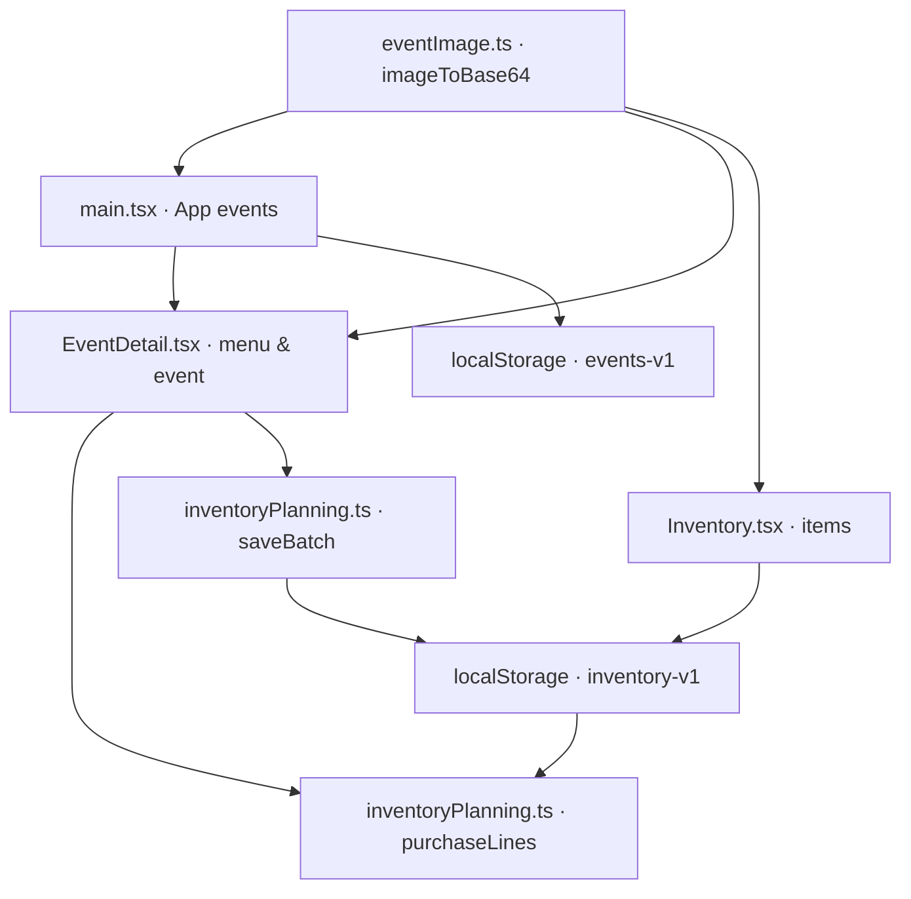

# Wandering BarBack — Variable Registry

Status: 2026-11-08. Bron: code op `main`. Dit is een register van **gedeelde, persistente en domeinbepalende** variabelen, niet van iedere tijdelijke callback- of loopvariabele. Bestandsnamen en symbolen zijn hoofdlettergevoelig.

| Symbool / veld | Gedefinieerd in | Gebruikt door | Betekenis / opslag |
|---|---|---|---|
| `Tab`, `tabs` | `src/main.tsx` | `App` | Navigatie: Home, Evenementen, Inventaris, Voorbereiding, Meer |
| `tab`, `setTab` | `App` in `src/main.tsx` | App-header, content, bottom-nav | Actief tabblad; React-state, niet persistent |
| `EventItem` | `src/main.tsx` | `App`, `readEvents`, `saveEvent` | Alias van `EventData` |
| `EventData` | `src/EventDetail.tsx` | `main.tsx`, `EventDetail` | Evenementmodel: id, title, date, city, guests, progress, status, photo en optionele velden |
| `sampleEvents` | `src/main.tsx` | `readEvents` | Voorbeeld-/fallback-events, waaronder ODW |
| `STORAGE_KEY` | `src/main.tsx` | `readEvents`, event-`useEffect` | `wandering-barback-events-v1` |
| `events`, `setEvents` | `App` in `src/main.tsx` | eventlijst, `saveEvent`, `createEvent` | Eventcollectie in React-state; opgeslagen als JSON |
| `selected`, `setSelected` | `App` | EventDetail openen/sluiten | Geselecteerd event |
| `form`, `setForm` | `App` | Eventaanmaakformulier | title, date, city, guests, service, photo |
| `filter`, `search`, `visibleEvents` | `App` | Eventoverzicht | Eventfilter, zoektekst en gefilterde resultaten |
| `imageToBase64` | `src/eventImage.ts` | `main.tsx`, `EventDetail.tsx`, `Inventory.tsx` | File → JPEG data-URL; gebruikt voor event- en productfoto |
| `Category`, `Item` | `src/Inventory.tsx` | Inventaris-UI, `inventoryPlanning.ts` | Inventariscategorie en artikeltype; `Item` is geëxporteerd |
| `Item.id`, `Item.name` | `Item` | inventaris en matching | Technische ID versus zichtbare naam; matching is nu vooral naamgebaseerd |
| `Item.quantity`, `Item.unit` | `Item` | `Inventory`, `available`, `saveBatch` | Voorraadhoeveelheid en eenheid; null betekent onbekend |
| `Item.price`, `Item.supplier`, `Item.brand` | `Item` | inventaris, `purchaseLines` | Referentieprijs, leverancier, merk; `brand` wordt soms gebruikt om flesinhoud te herkennen |
| `Item.recipe`, `Item.image` | `Item` | inventaris-UI | Vrije recepttekst en optionele Base64-data-URL |
| `categories` | `src/Inventory.tsx` | categorieën en formulier | Categorieën, subcategorieën en iconen |
| `seed`, `beverageCatalog`, `extraCatalog`, `homemadeStarter` | `src/Inventory.tsx` | seed-opbouw en `load` | Startcatalogus en zelfgemaakte artikelen |
| `verifiedPrices`, `gallPrices`, `gallBatch2…13` | `src/Inventory.tsx` | `applyVerifiedPrices` | Prijsbronnen voor (vooral) Gall & Gall; verificatiestatus per bron controleren |
| `ahFruitMixerBatch`, `newAhPrices`, `ahBatchTen/Twenty/Thirty/Forty` | `src/Inventory.tsx` | `applyVerifiedPrices` | AH-prijsreferenties |
| `syrupBatchTen`, `syrupBatchTwenty`, `preferredSyrupPrices` | `src/Inventory.tsx` | `applyVerifiedPrices` | Siroopprijzen en voorkeursalternatieven |
| `INVENTORY_STORAGE_KEY`, `key` | `src/Inventory.tsx` | `load`, inventaris-`useEffect`, `inventoryPlanning.ts` | `wandering-barback-inventory-v1` |
| `applyVerifiedPrices` | `src/Inventory.tsx` | `load` | Voegt standaardprijzen toe aan items; let op bescherming handmatige wijzigingen |
| `attachHomemadeRecipes` | `src/Inventory.tsx` | `load` | Koppelt startrecepten aan bestaande artikelen |
| `load`, `items`, `setItems` | `src/Inventory.tsx` | Inventariscomponent | Laadt, beheert en bewaart voorraad in localStorage |
| `draft`, `setDraft` | `Inventory` | Productmodal | Tijdelijke bewerkversie van inventarisartikel |
| `RECIPES` | `src/EventDetail.tsx` | Menukaart, `ingredients` | Cocktailcatalogus met ingrediënten en hoeveelheden per drankje |
| `menu`, `quantities` | `EventDetail` | Menukaart en `ingredients` | Geselecteerde cocktails en aantallen per cocktail |
| `ingredients` | `EventDetail` | Inkoopberekening | Geaggregeerde receptbehoeften vóór marge |
| `margin` / `purchaseMargin` | `EventDetail` / `EventData` | `purchaseLines` | Extra inkooppercentage per evenement |
| `lines` | `EventDetail` | Inkoop-tab | Resultaten van `purchaseLines` |
| `stockItems`, `setStockItems` | `EventDetail` | `purchaseLines`, `saveBatch` | Momentopname van lokale inventaris |
| `inventoryItems` | `src/inventoryPlanning.ts` | `EventDetail` | Leest voorraad uit localStorage |
| `aliases`, `matchItem` | `src/inventoryPlanning.ts` | `purchaseLines`, `saveBatch` | Naam-aliassen en productmatching |
| `Need`, `PurchaseLine` | `src/inventoryPlanning.ts` | `purchaseLines`, event-Inkoop | Gevraagde hoeveelheid en berekende voorraad/tekort/leverancier |
| `available`, `purchaseLines` | `src/inventoryPlanning.ts` | Event-Inkoop | Eenheidsconversie en voorraadvergelijking |
| `BatchRecipe`, `batchRecipes` | `src/inventoryPlanning.ts` | Event-Inkoop | Zelfmaakrecepten, doelvolume, grondstoffen en instructies |
| `batchName`, `batchAmount`, `batchMessage` | `EventDetail` | Batchformulier | Geselecteerd recept, geplande productie en feedback |
| `saveBatch` | `src/inventoryPlanning.ts` | `EventDetail` | Boekt grondstoffen af en output bij in localStorage |
| `schedule`, `packing`, `staff` | `EventDetail` (uit `event`) | Overzicht, Paklijst, Planning | Evenementdraaiboek, materialen en medewerkers |
| `DEFAULT_PACK`, `DEFAULT_SCHEDULE` | `src/EventDetail.tsx` | `EventDetail` init-effect | Standaard paklijst en draaiboek |

## Dataflow

## Belangrijke opslagvelden
- Event: `id` (number), `title`, `date` (momenteel displaytekst), `city`, `guests`, `progress`, `status`, `photo`, `menu`, `quantities`, `schedule`, `packing`, `staff`, `purchaseMargin`.
- Inventaris: `id`, `name`, `category`, `subcategory`, `quantity`, `unit`, `location`, `notes`, `brand`, `price`, `supplier`, `priceCheckedAt`, `webLink`, `recipe`, `image`.
- `photo` en `image` zijn data-URL's of (voor bestaande voorbeeld-events) gewone URL's. Niet aannemen dat alle waarden Base64 zijn.
- `quantity: null` betekent **niet geteld**, niet nul. `quantity: 0` betekent nul voorraad.
- `price` is momenteel niet consequent gekoppeld aan een expliciete verpakkingsmaat; kostenramingen zijn daarom beperkt betrouwbaar.

## Register onderhouden
Bij elke PR/commit met een nieuwe gedeelde variabele of opslagveld:
1. Noteer eigenaarbestand, type, betekenis, consument(en) en opslaglocatie.
2. Leg naamwijzigingen en migratie vast; vermijd duplicatie.
3. Markeer berekende waarden als derived, React-state als transient en opgeslagen velden als persisted.
4. Voeg bij opslagwijzigingen een migratie-/compatibiliteitstest toe.
5. Houd de diagram en roadmap synchroon.

## Centrale modellen en opslag — update 8 november 2026
| Symbool | Eigenaar | Consumenten | Opslag / status |
|---|---|---|---|
| `EventData`, `EventStatus`, `ScheduleItem`, `PackingItem`, `StaffMember`, `DeletedEvent` | `src/types/event.ts` | `main.tsx`, `EventDetail.tsx`, `eventRepository.ts` | Type-only; shape van bestaande eventrecords ongewijzigd |
| `Item`, `Category` | `src/types/inventory.ts` | `Inventory.tsx`, `inventoryPlanning.ts`, `inventoryRepository.ts` | Type-only; shape van bestaande inventarisrecords ongewijzigd |
| `EVENT_STORAGE_KEY` | `src/repositories/storageKeys.ts` | `eventRepository.ts` | `wandering-barback-events-v1` |
| `DELETED_EVENTS_STORAGE_KEY` | `src/repositories/storageKeys.ts` | `eventRepository.ts` | `wandering-barback-deleted-events-v1` |
| `INVENTORY_STORAGE_KEY` | `src/repositories/storageKeys.ts` | `Inventory.tsx`, `inventoryPlanning.ts`, `inventoryRepository.ts` | `wandering-barback-inventory-v1` |
| `readStoredEvents`, `writeStoredEvents` | `src/repositories/eventRepository.ts` | `main.tsx` | Actieve evenementen in bestaande localStorage key |
| `readStoredDeletedEvents`, `writeStoredDeletedEvents` | `src/repositories/eventRepository.ts` | `main.tsx` | Herstelarchief in bestaande localStorage key |
| `readStoredInventory`, `writeStoredInventory` | `src/repositories/inventoryRepository.ts` | Toekomstige inventarisrefactor | Voorbereid, nog niet verbonden met inventaris-UI |

**Compatibiliteit:** oude exports `EventDetail.EventData`, `Inventory.Item` en `Inventory.INVENTORY_STORAGE_KEY` blijven bestaan als re-exports. Geen schemawijziging of automatische migratie. 

## Dienstspecifieke menukaart — 8 november 2026
| Symbool | Eigenaar | Gebruikt in | Betekenis |
|---|---|---|---|
| `MenuKind`, `MenuEntry` | `src/data/menuCatalog.ts` | `EventDetail.tsx` | Type van drankcategorie en recept/serveerhoeveelheden |
| `COCKTAIL_RECIPES` | `src/data/menuCatalog.ts` | `MENU_CATALOG` | Bestaande cocktail- en mocktailrecepten, ongewijzigd overgenomen |
| `MENU_CATALOG` | `src/data/menuCatalog.ts` | `EventDetail.tsx` | Cocktail-, wijn-, bier- en G&T-startcatalogus |
| `serviceMenuKinds` | `src/data/menuCatalog.ts` | `EventDetail.tsx` | Toegestane drankcategorieën per dienst |
| `getMenuEntry` | `src/data/menuCatalog.ts` | `EventDetail.tsx` | Naamgebaseerde receptlookup voor inkoop |
| `allowedKinds`, `availableMenu`, `visibleMenu` | `EventDetail` | Menukaart-UI | Afgeleide filterwaarden; niet opgeslagen |
| `maxMenuItems`, `menuTitle` | `EventDetail` | Menukaart-UI | Dienstspecifieke limiet en koptekst; niet opgeslagen |

Bestaande persistente velden `event.service`, `event.menu` en `event.quantities` blijven ongewijzigd. Nieuwe dranken zijn voorlopig startvoorbeelden en geen geverifieerde voorraadproducten.

## Speciaalbierbar-catalogus — 8 november 2026
| Symbool | Eigenaar | Gebruik | Opslag |
|---|---|---|---|
| `beerBarStarter` | `src/Inventory.tsx` | 3 BLADE-fusten, tapinstallatie, ijsbak en 3 flesbieropties | Nieuwe records krijgen `quantity:null`; bestaande records worden behouden |
| `addBeerBarOptions` | `src/Inventory.tsx` | Aanvullen ontbrekende catalogusopties na legacy-inventarisload | Bestaande `wandering-barback-inventory-v1` key, zonder schemawijziging |

## Bierbarplanning — 8 november 2026
| Symbool | Eigenaar | Consument | Betekenis |
|---|---|---|---|
| `BeerBarPlan` | `src/planning/beerBar.ts` | `EventData.beerBarPlan`, `EventDetail` | Optionele configuratie voor 3 taps, flesbier en ijsbakken |
| `BLADE_BEERS`, `BOTTLED_BEERS` | `src/planning/beerBar.ts` | `EventDetail` | Selecteerbare bieropties |
| `defaultBeerBarPlan`, `normalizeBeerBarPlan` | `src/planning/beerBar.ts` | `EventDetail` | Niet-destructieve standaardconfiguratie voor oudere events |
| `beerBarRequirements`, `beerBarPacking` | `src/planning/beerBar.ts` | `EventDetail` | Berekening van fusten, flesjes, ijsbakken, ijs en paklijst |
| `beerIngredients` | `EventDetail` | `purchaseLines` | Inkoopbehoefte voor bierbar uit optioneel eventplan |

## Flesbiercatalogus (8 november 2026)
| Symbool | Eigenaar | Consument | Betekenis |
|---|---|---|---|
| `bottledBeerCatalog` | `src/Inventory.tsx` | `addBeerBarOptions` | 28 merkgebonden flesbieropties met onbekende voorraad, zonder vaste prijzen of flesformaten |

| `BOTTLED_BEER_CATALOG` | `src/planning/beerBar.ts` | `EventDetail` | Vaste fallback voor 28 flesbieropties, ook als inventaris nog niet is bezocht |
| `bottledBeerOptions` | `EventDetail` | Flesbiersectie bij Speciaalbierbar | Unieke combinatie van catalogus, aanwezige inventarisopties en opgeslagen eventselecties |

## Dienstspecifieke menu-filtering (9 november 2026)
| Symbool | Eigenaar | Consument | Betekenis |
|---|---|---|---|
| `availableMenu`, `activeMenu` | `EventDetail` | Menukaart, hoeveelheden en inkoop | Alleen menu-items passend bij gekozen dienst; bierbar gebruikt aparte bierplanning |
| `SERVICE_OPTIONS` | `src/data/menuCatalog.ts` | Eventdetail dienstselector | Gedefinieerde diensten en hun menukeuzes |

## Centrale catalogus (9 november 2026)
| Symbool | Eigenaar | Consument | Betekenis |
|---|---|---|---|
| `CATALOG_STORAGE_KEY` | `src/data/menuCatalog.ts` | `readMenuCatalog`, `writeMenuCatalog` | `wandering-barback-catalog-v1` voor recepten en menu-items |
| `readMenuCatalog` | `src/data/menuCatalog.ts` | `Catalog`, `EventDetail`, `getMenuEntry` | Opgeslagen catalogus, of startcatalogus als geen opslag bestaat |
| `writeMenuCatalog` | `src/data/menuCatalog.ts` | `Catalog` | Slaat catalogus op en verstuurt `wandering-catalog-updated` |

## Audit en correcties — 9 november 2026
Het register inventariseert gedeelde, persistente en domeinbepalende symbolen, **niet elke lokale variabele**. Eerdere historische tabellen blijven leesbaar, maar onderstaande actuele definities gaan voor bij tegenstrijdigheid.

| Actueel symbool / veld | Eigenaar | Gebruikt door | Type / opslag |
|---|---|---|---|
| `Tab`, `tabs`, `tab`, `setTab` | `src/main.tsx` | `App` | UI-navigatie via React-state; geen URL-router |
| `settingsPage`, `setSettingsPage` | `src/main.tsx` | Meer → Instellingen/Catalogus/Verwijderde evenementen | React-state `main \| catalog \| deleted` |
| `Catalog` | `src/Catalog.tsx` | `src/main.tsx` | Beheerscherm voor drankcatalogus |
| `kind`, `entries`, `editing`, `original`, `error` | `Catalog` | Catalogusfilter en editor | Tijdelijke React-state; `entries` afkomstig uit localStorage |
| `CATALOG_STORAGE_KEY` | `src/data/menuCatalog.ts` | `readMenuCatalog`, `writeMenuCatalog` | Persistent `wandering-barback-catalog-v1`; nog niet centraal in `storageKeys.ts` |
| `COCKTAIL_RECIPES`, `MENU_CATALOG` | `src/data/menuCatalog.ts` | Catalogusfallback | Startrecepten en -menu's |
| `readMenuCatalog`, `writeMenuCatalog`, `getMenuEntry` | `src/data/menuCatalog.ts` | `Catalog`, `EventDetail` | Lezen, opslaan en lookup van recepten |
| `catalog`, `setCatalog` | `EventDetail` | `availableMenu`, menukaart | React-state, herladen bij storage/catalogus-event |
| `allowedKinds`, `availableMenu`, `activeMenu`, `visibleMenu` | `EventDetail` | Dienstspecifieke menukaart en inkoop | Afgeleide, niet-persistente filters |
| `BeerBarPlan`, `EventData.beerBarPlan` | `src/planning/beerBar.ts`, `src/types/event.ts` | `EventDetail` | Optioneel persistent eventveld |
| `BLADE_BEERS`, `BOTTLED_BEER_CATALOG`, `BOTTLED_BEERS` | `src/planning/beerBar.ts` | `EventDetail` | Tapopties, 28 flesbieropties, legacy generieke bieropties |
| `bottledBeerCatalog`, `beerBarStarter`, `addBeerBarOptions` | `src/Inventory.tsx` | Inventarisload | Nieuwe bierproducten, `quantity:null` tot geteld |
| `bottledBeerOptions`, `beerPlan`, `beerNeeds`, `beerPacking` | `EventDetail` | Speciaalbierbar, inkoop, paklijst | Afgeleid van catalogus/inventaris en eventplan |
| `EVENT_STORAGE_KEY`, `DELETED_EVENTS_STORAGE_KEY`, `INVENTORY_STORAGE_KEY` | `src/repositories/storageKeys.ts` | Repositories, inventarisplanning | Bestaande persistente keys; ongewijzigd |

**Verouderde vermeldingen in de oorspronkelijke tabel:** `STORAGE_KEY` als eigenaar in `main.tsx` en `RECIPES` in `EventDetail.tsx` zijn niet meer actueel. Gebruik respectievelijk `EVENT_STORAGE_KEY` en `readMenuCatalog`/`getMenuEntry`.

**Belangrijk:** geen volledige statische symbolenindex of compile-/routetest uitgevoerd. Bij nieuwe modules en wijzigingen moet dit register verder worden bijgewerkt.

## Verplicht registerprotocol — vanaf 9 november 2026
- Voor nieuwe gedeelde symbolen: eerst zoeken naar een bestaande definitie en importeren/hergebruiken in plaats van dupliceren.
- Eén canonieke eigenaar per type, functie, configuratie, opslagkey of domeinberekening; noteer naam, type, bestand, consumenten, persistentie en migratie-effect.
- Bij hernoemen of verwijderen: alle consumenten en dit register gelijktijdig aanpassen; verouderde vermeldingen corrigeren of expliciet als historisch markeren.
- Geen registratie van iedere tijdelijke loopvariabele: alleen gedeelde, persistente en architectuurbepalende symbolen, om het register onderhoudbaar te houden.
- Controleer bij iedere wijziging ook `docs/CODE_ROADMAP.md` en eventuele wijzigingen in navigatie en gegevensstromen.
- Typecheck, build en regressietests uitvoeren waar beschikbaar; ontbrekende verificatie zichtbaar vastleggen.

## Meer-detailnavigatie (9 november 2026)
| Symbool / klasse | Eigenaar | Consument | Betekenis |
|---|---|---|---|
| `settingsPage`, `setSettingsPage` | `src/main.tsx` | Meer en fullscreen detailoverlay | React-state: `main \| catalog \| deleted`; niet persistent |
| `more-fullscreen`, `more-fullscreen-inner`, `more-fullscreen-header`, `more-fullscreen-content` | `src/style.css` | Meer-detailpagina's | Schermvullende presentatie, veilige scrollcontainer en header; geen afzonderlijke URL-route |

## Automatische menukaartontwerpen (9 november 2026)
| Symbool | Eigenaar | Gebruikt door | Status |
|---|---|---|---|
| `menuDesign`, `setMenuDesign` | `src/EventDetail.tsx` | Menukaartontwerper | React-state `signature \| minimal \| elegant`, niet persistent |
| `printMenuItems` | `src/EventDetail.tsx` | Live preview en print | Afgeleid van `activeMenu` en `catalog` of `beerPlan`; geen duplicaat van receptdata |
| `ed-menu-print`, `ed-design-*`, `ed-menu-paper` | `src/EventDetail.css` | Menukaartontwerper | A4-print- en previewstyling |

## Herbruikbare menukaarttemplates (9 november 2026)
| Symbool | Eigenaar | Consument | Betekenis |
|---|---|---|---|
| `MENU_TEMPLATES`, `MenuTemplateId`, `MenuFrameStyle` | `src/data/menuTemplates.ts` | `EventDetail.tsx` | Canonieke kleurpaletten en types voor lijstafwerking |
| `menuFrame`, `setMenuFrame` | `src/EventDetail.tsx` | Live menukaart | Tijdelijke UI-keuze: `plain \| ornate`; nog niet per evenement opgeslagen |
| `ed-frame-ornate` | `src/EventDetail.css` | Preview en print | Ingezette dubbele sierlijn en ornamenten, met printmarge |

## Printformaat menukaart (9 november 2026)
| Symbool | Eigenaar | Consument | Betekenis |
|---|---|---|---|
| `MENU_PRINT_SIZES`, `MenuPrintSize` | `src/data/menuTemplates.ts` | `EventDetail.tsx` | Canonieke A4/A5 afmetingen in mm |
| `menuSize`, `setMenuSize` | `src/EventDetail.tsx` | Menukaartontwerper | Tijdelijke keuze A4/A5, niet persistent |
| `ed-size-a4`, `ed-size-a5` | `src/EventDetail.css` | Print en preview | Afdrukformaat, tekst- en ornamentmarges |
