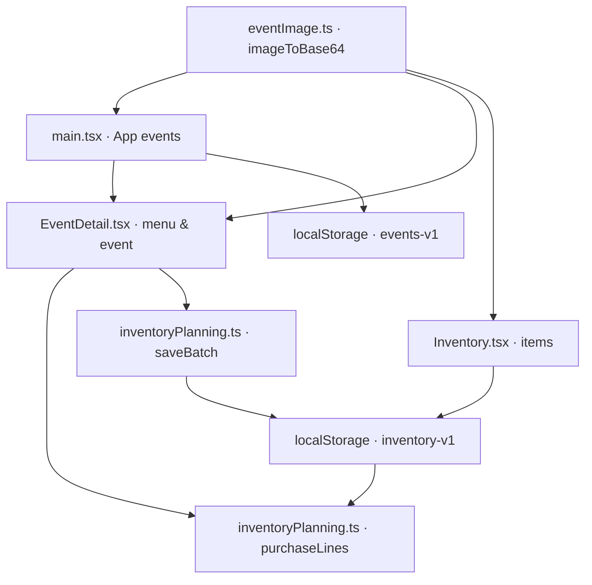

# Wandering BarBack — Variable Registry

## Firebase en synchronisatie — 10 november 2026

**Dubbele-ID-herstel:** `src/cloud/localRows.ts` bezit `Dataset`, `Row`, `parsed()` en `rowsFromLocal()`. Bij hergebruik van een `inventory.id` genereert `rowsFromLocal` een unieke `-local-N`-suffix in de cloudrepresentatie; de overige datasets blokkeren onveilige duplicaten. `PreparedSync.canMerge` en `PreparedSync.localProblem` sturen de beschikbare keuzes op het inlogscherm. `PreparedSync.activate('cloud')` vervangt uitsluitend de vier gegevenssets van de browser; geen algemene cacheclear. Regressietests: `tests/localRows.test.mjs`, uitgevoerd met `npm test`.

| Symbool / opslag | Eigenaar | Betekenis |
|---|---|---|
| `firebaseConfig`, `auth`, `db` | `src/firebase.ts` | Firebase webconfiguratie, Google Authentication en Firestore-instantie (`barback-20df5`) |
| `DATASETS`, `Dataset` | `src/cloud/storageSync.ts` | `events`, `deletedEvents`, `inventory`, `catalog`; overeenkomstige lokale keys en Firestore-subcollecties |
| `RawLocal`, `readLocal()` | `src/cloud/storageSync.ts` | Momentopname van de vier ongewijzigde legacy-localStorage JSON-waarden |
| `users/{uid}/{dataset}/{recordId}` | Firestore / `storageSync.ts` | Accountgebonden records met `value` (JSON-string) en `position` (lijstvolgorde) |
| `users/{uid}/meta/workspace` | Firestore / `storageSync.ts` | Initialisatiemarker: onderscheid tussen nieuw account en bewust lege datasets |
| `barback-firebase-local-owner-v1` | `storageSync.ts` | UID-eigenaar van de browserkopie; voorkomt accountvermenging |
| `barback-firebase-synced-v1-{uid}` | `storageSync.ts` | Fingerprint van laatst gesynchroniseerde lokale dataset; voorkomt onbedoelde conflictkeuzes |
| `prepareSync()`, `PreparedSync.activate()` | `storageSync.ts` | Servergegevens ophalen, conflict detecteren, lokale upload / back-up / merge / cloudkeuze |
| `startLiveSync()` | `storageSync.ts` | Firestore listeners, periodieke lokale upload, voortgang en conflictstop |
| `barback-sync-request` | `CloudGate.tsx` → `storageSync.ts` | Browser-event: controleer lokale gegevens direct op nog niet geüploade wijzigingen |
| `syncStatus` | `CloudGate.tsx` | React-state `synced`, `syncing` of `error`; getoond in de verbindingsbalk |
| `remoteChange` | `CloudGate.tsx` | React-state: externe wijziging ontvangen; gebruiker moet verversen |

**Belangrijk:** browserdata kunnen pas naar Firestore worden geüpload nadat de betreffende gebruiker met Google is aangemeld. De code kan geen lokaal opgeslagen gegevens uit de browser van de eigenaar op afstand uitlezen. De daadwerkelijke upload vereist daarom een eerste ingelogde sessie op dat apparaat.

Status: 2026-11-08. Bron: code op `main`. Dit is een register van **gedeelde, persistente en domeinbepalende** variabelen, niet van iedere tijdelijke callback- of loopvariabele. Bestandsnamen en symbolen zijn hoofdlettergevoelig.

| Symbool / veld | Gedefinieerd in | Gebruikt door | Betekenis / opslag |
|---|---|---|---|
| `Tab`, `tabs` | `src/main.tsx` | `App` | Navigatie: Home, Evenementen, Inventaris, Voorbereiding, Meer |
| `tab`, `setTab` | `App` in `src/main.tsx` | App-header, content, bottom-nav | Actief tabblad; React-state, niet persistent |
| `EventItem` | `src/main.tsx` | `App`, `readEvents`, `saveEvent` | Alias van `EventData` |
| `EventData` | `src/EventDetail.tsx` | `main.tsx`, `EventDetail` | Evenementmodel: id, title, date, city, guests, progress, status, photo en optionele velden |
| `sampleEvents` | `src/main.tsx` | `readEvents` | Voorbeeld-/fallback-events, waaronder ODW |
| `STORAGE_KEY` | `src/main.tsx` | `readEvents`, event-`useEffect` | `wandering-barback-events-v1` |
| `events`, `setEvents` | `App` in `src/main.tsx` | eventlijst, `saveEvent`, `createEvent` | Eventcollectie in React-state; opgeslagen als JSON |
| `selected`, `setSelected` | `App` | EventDetail openen/sluiten | Geselecteerd event |
| `form`, `setForm` | `App` | Eventaanmaakformulier | title, date, city, guests, service, photo |
| `filter`, `search`, `visibleEvents` | `App` | Eventoverzicht | Eventfilter, zoektekst en gefilterde resultaten |
| `imageToBase64` | `src/eventImage.ts` | `main.tsx`, `EventDetail.tsx`, `Inventory.tsx` | File → JPEG data-URL; gebruikt voor event- en productfoto |
| `Category`, `Item` | `src/Inventory.tsx` | Inventaris-UI, `inventoryPlanning.ts` | Inventariscategorie en artikeltype; `Item` is geëxporteerd |
| `Item.id`, `Item.name` | `Item` | inventaris en matching | Technische ID versus zichtbare naam; matching is nu vooral naamgebaseerd |
| `Item.quantity`, `Item.unit` | `Item` | `Inventory`, `available`, `saveBatch` | Voorraadhoeveelheid en eenheid; null betekent onbekend |
| `Item.price`, `Item.supplier`, `Item.brand` | `Item` | inventaris, `purchaseLines` | Referentieprijs, leverancier, merk; `brand` wordt soms gebruikt om flesinhoud te herkennen |
| `Item.recipe`, `Item.image` | `Item` | inventaris-UI | Vrije recepttekst en optionele Base64-data-URL |
| `categories` | `src/Inventory.tsx` | categorieën en formulier | Categorieën, subcategorieën en iconen |
| `seed`, `beverageCatalog`, `extraCatalog`, `homemadeStarter` | `src/Inventory.tsx` | seed-opbouw en `load` | Startcatalogus en zelfgemaakte artikelen |
| `verifiedPrices`, `gallPrices`, `gallBatch2…13` | `src/Inventory.tsx` | `applyVerifiedPrices` | Prijsbronnen voor (vooral) Gall & Gall; verificatiestatus per bron controleren |
| `ahFruitMixerBatch`, `newAhPrices`, `ahBatchTen/Twenty/Thirty/Forty` | `src/Inventory.tsx` | `applyVerifiedPrices` | AH-prijsreferenties |
| `syrupBatchTen`, `syrupBatchTwenty`, `preferredSyrupPrices` | `src/Inventory.tsx` | `applyVerifiedPrices` | Siroopprijzen en voorkeursalternatieven |
| `INVENTORY_STORAGE_KEY`, `key` | `src/Inventory.tsx` | `load`, inventaris-`useEffect`, `inventoryPlanning.ts` | `wandering-barback-inventory-v1` |
| `applyVerifiedPrices` | `src/Inventory.tsx` | `load` | Voegt standaardprijzen toe aan items; let op bescherming handmatige wijzigingen |
| `attachHomemadeRecipes` | `src/Inventory.tsx` | `load` | Koppelt startrecepten aan bestaande artikelen |
| `load`, `items`, `setItems` | `src/Inventory.tsx` | Inventariscomponent | Laadt, beheert en bewaart voorraad in localStorage |
| `draft`, `setDraft` | `Inventory` | Productmodal | Tijdelijke bewerkversie van inventarisartikel |
| `RECIPES` | `src/EventDetail.tsx` | Menukaart, `ingredients` | Cocktailcatalogus met ingrediënten en hoeveelheden per drankje |
| `menu`, `quantities` | `EventDetail` | Menukaart en `ingredients` | Geselecteerde cocktails en aantallen per cocktail |
| `ingredients` | `EventDetail` | Inkoopberekening | Geaggregeerde receptbehoeften vóór marge |
| `margin` / `purchaseMargin` | `EventDetail` / `EventData` | `purchaseLines` | Extra inkooppercentage per evenement |
| `lines` | `EventDetail` | Inkoop-tab | Resultaten van `purchaseLines` |
| `stockItems`, `setStockItems` | `EventDetail` | `purchaseLines`, `saveBatch` | Momentopname van lokale inventaris |
| `inventoryItems` | `src/inventoryPlanning.ts` | `EventDetail` | Leest voorraad uit localStorage |
| `aliases`, `matchItem` | `src/inventoryPlanning.ts` | `purchaseLines`, `saveBatch` | Naam-aliassen en productmatching |
| `Need`, `PurchaseLine` | `src/inventoryPlanning.ts` | `purchaseLines`, event-Inkoop | Gevraagde hoeveelheid en berekende voorraad/tekort/leverancier |
| `available`, `purchaseLines` | `src/inventoryPlanning.ts` | Event-Inkoop | Eenheidsconversie en voorraadvergelijking |
| `BatchRecipe`, `batchRecipes` | `src/inventoryPlanning.ts` | Event-Inkoop | Zelfmaakrecepten, doelvolume, grondstoffen en instructies |
| `batchName`, `batchAmount`, `batchMessage` | `EventDetail` | Batchformulier | Geselecteerd recept, geplande productie en feedback |
| `saveBatch` | `src/inventoryPlanning.ts` | `EventDetail` | Boekt grondstoffen af en output bij in localStorage |
| `schedule`, `packing`, `staff` | `EventDetail` (uit `event`) | Overzicht, Paklijst, Planning | Evenementdraaiboek, materialen en medewerkers |
| `DEFAULT_PACK`, `DEFAULT_SCHEDULE` | `src/EventDetail.tsx` | `EventDetail` init-effect | Standaard paklijst en draaiboek |

## Dataflow

## Belangrijke opslagvelden
- Event: `id` (number), `title`, `date` (momenteel displaytekst), `city`, `guests`, `progress`, `status`, `photo`, `menu`, `quantities`, `schedule`, `packing`, `staff`, `purchaseMargin`.
- Inventaris: `id`, `name`, `category`, `subcategory`, `quantity`, `unit`, `location`, `notes`, `brand`, `price`, `supplier`, `priceCheckedAt`, `webLink`, `recipe`, `image`.
- `photo` en `image` zijn data-URL's of (voor bestaande voorbeeld-events) gewone URL's. Niet aannemen dat alle waarden Base64 zijn.
- `quantity: null` betekent **niet geteld**, niet nul. `quantity: 0` betekent nul voorraad.
- `price` is momenteel niet consequent gekoppeld aan een expliciete verpakkingsmaat; kostenramingen zijn daarom beperkt betrouwbaar.

## Register onderhouden
Bij elke PR/commit met een nieuwe gedeelde variabele of opslagveld:
1. Noteer eigenaarbestand, type, betekenis, consument(en) en opslaglocatie.
2. Leg naamwijzigingen en migratie vast; vermijd duplicatie.
3. Markeer berekende waarden als derived, React-state als transient en opgeslagen velden als persisted.
4. Voeg bij opslagwijzigingen een migratie-/compatibiliteitstest toe.
5. Houd de diagram en roadmap synchroon.

## Centrale modellen en opslag — update 8 november 2026
| Symbool | Eigenaar | Consumenten | Opslag / status |
|---|---|---|---|
| `EventData`, `EventStatus`, `ScheduleItem`, `PackingItem`, `StaffMember`, `DeletedEvent` | `src/types/event.ts` | `main.tsx`, `EventDetail.tsx`, `eventRepository.ts` | Type-only; shape van bestaande eventrecords ongewijzigd |
| `Item`, `Category` | `src/types/inventory.ts` | `Inventory.tsx`, `inventoryPlanning.ts`, `inventoryRepository.ts` | Type-only; shape van bestaande inventarisrecords ongewijzigd |
| `EVENT_STORAGE_KEY` | `src/repositories/storageKeys.ts` | `eventRepository.ts` | `wandering-barback-events-v1` |
| `DELETED_EVENTS_STORAGE_KEY` | `src/repositories/storageKeys.ts` | `eventRepository.ts` | `wandering-barback-deleted-events-v1` |
| `INVENTORY_STORAGE_KEY` | `src/repositories/storageKeys.ts` | `Inventory.tsx`, `inventoryPlanning.ts`, `inventoryRepository.ts` | `wandering-barback-inventory-v1` |
| `readStoredEvents`, `writeStoredEvents` | `src/repositories/eventRepository.ts` | `main.tsx` | Actieve evenementen in bestaande localStorage key |
| `readStoredDeletedEvents`, `writeStoredDeletedEvents` | `src/repositories/eventRepository.ts` | `main.tsx` | Herstelarchief in bestaande localStorage key |
| `readStoredInventory`, `writeStoredInventory` | `src/repositories/inventoryRepository.ts` | Toekomstige inventarisrefactor | Voorbereid, nog niet verbonden met inventaris-UI |

**Compatibiliteit:** oude exports `EventDetail.EventData`, `Inventory.Item` en `Inventory.INVENTORY_STORAGE_KEY` blijven bestaan als re-exports. Geen schemawijziging of automatische migratie. 

## Dienstspecifieke menukaart — 8 november 2026
| Symbool | Eigenaar | Gebruikt in | Betekenis |
|---|---|---|---|
| `MenuKind`, `MenuEntry` | `src/data/menuCatalog.ts` | `EventDetail.tsx` | Type van drankcategorie en recept/serveerhoeveelheden |
| `COCKTAIL_RECIPES` | `src/data/menuCatalog.ts` | `MENU_CATALOG` | Bestaande cocktail- en mocktailrecepten, ongewijzigd overgenomen |
| `MENU_CATALOG` | `src/data/menuCatalog.ts` | `EventDetail.tsx` | Cocktail-, wijn-, bier- en G&T-startcatalogus |
| `serviceMenuKinds` | `src/data/menuCatalog.ts` | `EventDetail.tsx` | Toegestane drankcategorieën per dienst |
| `getMenuEntry` | `src/data/menuCatalog.ts` | `EventDetail.tsx` | Naamgebaseerde receptlookup voor inkoop |
| `allowedKinds`, `availableMenu`, `visibleMenu` | `EventDetail` | Menukaart-UI | Afgeleide filterwaarden; niet opgeslagen |
| `maxMenuItems`, `menuTitle` | `EventDetail` | Menukaart-UI | Dienstspecifieke limiet en koptekst; niet opgeslagen |

Bestaande persistente velden `event.service`, `event.menu` en `event.quantities` blijven ongewijzigd. Nieuwe dranken zijn voorlopig startvoorbeelden en geen geverifieerde voorraadproducten.

## Speciaalbierbar-catalogus — 8 november 2026
| Symbool | Eigenaar | Gebruik | Opslag |
|---|---|---|---|
| `beerBarStarter` | `src/Inventory.tsx` | 3 BLADE-fusten, tapinstallatie, ijsbak en 3 flesbieropties | Nieuwe records krijgen `quantity:null`; bestaande records worden behouden |
| `addBeerBarOptions` | `src/Inventory.tsx` | Aanvullen ontbrekende catalogusopties na legacy-inventarisload | Bestaande `wandering-barback-inventory-v1` key, zonder schemawijziging |

## Bierbarplanning — 8 november 2026
| Symbool | Eigenaar | Consument | Betekenis |
|---|---|---|---|
| `BeerBarPlan` | `src/planning/beerBar.ts` | `EventData.beerBarPlan`, `EventDetail` | Optionele configuratie voor 3 taps, flesbier en ijsbakken |
| `BLADE_BEERS`, `BOTTLED_BEERS` | `src/planning/beerBar.ts` | `EventDetail` | Selecteerbare bieropties |
| `defaultBeerBarPlan`, `normalizeBeerBarPlan` | `src/planning/beerBar.ts` | `EventDetail` | Niet-destructieve standaardconfiguratie voor oudere events |
| `beerBarRequirements`, `beerBarPacking` | `src/planning/beerBar.ts` | `EventDetail` | Berekening van fusten, flesjes, ijsbakken, ijs en paklijst |
| `beerIngredients` | `EventDetail` | `purchaseLines` | Inkoopbehoefte voor bierbar uit optioneel eventplan |

## Flesbiercatalogus (8 november 2026)
| Symbool | Eigenaar | Consument | Betekenis |
|---|---|---|---|
| `bottledBeerCatalog` | `src/Inventory.tsx` | `addBeerBarOptions` | 28 merkgebonden flesbieropties met onbekende voorraad, zonder vaste prijzen of flesformaten |

| `BOTTLED_BEER_CATALOG` | `src/planning/beerBar.ts` | `EventDetail` | Vaste fallback voor 28 flesbieropties, ook als inventaris nog niet is bezocht |
| `bottledBeerOptions` | `EventDetail` | Flesbiersectie bij Speciaalbierbar | Unieke combinatie van catalogus, aanwezige inventarisopties en opgeslagen eventselecties |

## Dienstspecifieke menu-filtering (9 november 2026)
| Symbool | Eigenaar | Consument | Betekenis |
|---|---|---|---|
| `availableMenu`, `activeMenu` | `EventDetail` | Menukaart, hoeveelheden en inkoop | Alleen menu-items passend bij gekozen dienst; bierbar gebruikt aparte bierplanning |
| `SERVICE_OPTIONS` | `src/data/menuCatalog.ts` | Eventdetail dienstselector | Gedefinieerde diensten en hun menukeuzes |

## Centrale catalogus (9 november 2026)
| Symbool | Eigenaar | Consument | Betekenis |
|---|---|---|---|
| `CATALOG_STORAGE_KEY` | `src/data/menuCatalog.ts` | `readMenuCatalog`, `writeMenuCatalog` | `wandering-barback-catalog-v1` voor recepten en menu-items |
| `readMenuCatalog` | `src/data/menuCatalog.ts` | `Catalog`, `EventDetail`, `getMenuEntry` | Opgeslagen catalogus, of startcatalogus als geen opslag bestaat |
| `writeMenuCatalog` | `src/data/menuCatalog.ts` | `Catalog` | Slaat catalogus op en verstuurt `wandering-catalog-updated` |

## Audit en correcties — 9 november 2026
Het register inventariseert gedeelde, persistente en domeinbepalende symbolen, **niet elke lokale variabele**. Eerdere historische tabellen blijven leesbaar, maar onderstaande actuele definities gaan voor bij tegenstrijdigheid.

| Actueel symbool / veld | Eigenaar | Gebruikt door | Type / opslag |
|---|---|---|---|
| `Tab`, `tabs`, `tab`, `setTab` | `src/main.tsx` | `App` | UI-navigatie via React-state; geen URL-router |
| `settingsPage`, `setSettingsPage` | `src/main.tsx` | Meer → Instellingen/Catalogus/Verwijderde evenementen | React-state `main \| catalog \| deleted` |
| `Catalog` | `src/Catalog.tsx` | `src/main.tsx` | Beheerscherm voor drankcatalogus |
| `kind`, `entries`, `editing`, `original`, `error` | `Catalog` | Catalogusfilter en editor | Tijdelijke React-state; `entries` afkomstig uit localStorage |
| `CATALOG_STORAGE_KEY` | `src/data/menuCatalog.ts` | `readMenuCatalog`, `writeMenuCatalog` | Persistent `wandering-barback-catalog-v1`; nog niet centraal in `storageKeys.ts` |
| `COCKTAIL_RECIPES`, `MENU_CATALOG` | `src/data/menuCatalog.ts` | Catalogusfallback | Startrecepten en -menu's |
| `readMenuCatalog`, `writeMenuCatalog`, `getMenuEntry` | `src/data/menuCatalog.ts` | `Catalog`, `EventDetail` | Lezen, opslaan en lookup van recepten |
| `catalog`, `setCatalog` | `EventDetail` | `availableMenu`, menukaart | React-state, herladen bij storage/catalogus-event |
| `allowedKinds`, `availableMenu`, `activeMenu`, `visibleMenu` | `EventDetail` | Dienstspecifieke menukaart en inkoop | Afgeleide, niet-persistente filters |
| `BeerBarPlan`, `EventData.beerBarPlan` | `src/planning/beerBar.ts`, `src/types/event.ts` | `EventDetail` | Optioneel persistent eventveld |
| `BLADE_BEERS`, `BOTTLED_BEER_CATALOG`, `BOTTLED_BEERS` | `src/planning/beerBar.ts` | `EventDetail` | Tapopties, 28 flesbieropties, legacy generieke bieropties |
| `bottledBeerCatalog`, `beerBarStarter`, `addBeerBarOptions` | `src/Inventory.tsx` | Inventarisload | Nieuwe bierproducten, `quantity:null` tot geteld |
| `bottledBeerOptions`, `beerPlan`, `beerNeeds`, `beerPacking` | `EventDetail` | Speciaalbierbar, inkoop, paklijst | Afgeleid van catalogus/inventaris en eventplan |
| `EVENT_STORAGE_KEY`, `DELETED_EVENTS_STORAGE_KEY`, `INVENTORY_STORAGE_KEY` | `src/repositories/storageKeys.ts` | Repositories, inventarisplanning | Bestaande persistente keys; ongewijzigd |

**Verouderde vermeldingen in de oorspronkelijke tabel:** `STORAGE_KEY` als eigenaar in `main.tsx` en `RECIPES` in `EventDetail.tsx` zijn niet meer actueel. Gebruik respectievelijk `EVENT_STORAGE_KEY` en `readMenuCatalog`/`getMenuEntry`.

**Belangrijk:** geen volledige statische symbolenindex of compile-/routetest uitgevoerd. Bij nieuwe modules en wijzigingen moet dit register verder worden bijgewerkt.

## Verplicht registerprotocol — vanaf 9 november 2026
- Voor nieuwe gedeelde symbolen: eerst zoeken naar een bestaande definitie en importeren/hergebruiken in plaats van dupliceren.
- Eén canonieke eigenaar per type, functie, configuratie, opslagkey of domeinberekening; noteer naam, type, bestand, consumenten, persistentie en migratie-effect.
- Bij hernoemen of verwijderen: alle consumenten en dit register gelijktijdig aanpassen; verouderde vermeldingen corrigeren of expliciet als historisch markeren.
- Geen registratie van iedere tijdelijke loopvariabele: alleen gedeelde, persistente en architectuurbepalende symbolen, om het register onderhoudbaar te houden.
- Controleer bij iedere wijziging ook `docs/CODE_ROADMAP.md` en eventuele wijzigingen in navigatie en gegevensstromen.
- Typecheck, build en regressietests uitvoeren waar beschikbaar; ontbrekende verificatie zichtbaar vastleggen.

## Meer-detailnavigatie (9 november 2026)
| Symbool / klasse | Eigenaar | Consument | Betekenis |
|---|---|---|---|
| `settingsPage`, `setSettingsPage` | `src/main.tsx` | Meer en fullscreen detailoverlay | React-state: `main \| catalog \| deleted`; niet persistent |
| `more-fullscreen`, `more-fullscreen-inner`, `more-fullscreen-header`, `more-fullscreen-content` | `src/style.css` | Meer-detailpagina's | Schermvullende presentatie, veilige scrollcontainer en header; geen afzonderlijke URL-route |

## Automatische menukaartontwerpen (9 november 2026)
| Symbool | Eigenaar | Gebruikt door | Status |
|---|---|---|---|
| `menuDesign`, `setMenuDesign` | `src/EventDetail.tsx` | Menukaartontwerper | React-state `signature \| minimal \| elegant`, niet persistent |
| `printMenuItems` | `src/EventDetail.tsx` | Live preview en print | Afgeleid van `activeMenu` en `catalog` of `beerPlan`; geen duplicaat van receptdata |
| `ed-menu-print`, `ed-design-*`, `ed-menu-paper` | `src/EventDetail.css` | Menukaartontwerper | A4-print- en previewstyling |

## Herbruikbare menukaarttemplates (9 november 2026)
| Symbool | Eigenaar | Consument | Betekenis |
|---|---|---|---|
| `MENU_TEMPLATES`, `MenuTemplateId`, `MenuFrameStyle` | `src/data/menuTemplates.ts` | `EventDetail.tsx` | Canonieke kleurpaletten en types voor lijstafwerking |
| `menuFrame`, `setMenuFrame` | `src/EventDetail.tsx` | Live menukaart | Tijdelijke UI-keuze: `plain \| ornate`; nog niet per evenement opgeslagen |
| `ed-frame-ornate` | `src/EventDetail.css` | Preview en print | Ingezette dubbele sierlijn en ornamenten, met printmarge |

## Printformaat menukaart (9 november 2026)
| Symbool | Eigenaar | Consument | Betekenis |
|---|---|---|---|
| `MENU_PRINT_SIZES`, `MenuPrintSize` | `src/data/menuTemplates.ts` | `EventDetail.tsx` | Canonieke A4/A5 afmetingen in mm |
| `menuSize`, `setMenuSize` | `src/EventDetail.tsx` | Menukaartontwerper | Tijdelijke keuze A4/A5, niet persistent |
| `ed-size-a4`, `ed-size-a5` | `src/EventDetail.css` | Print en preview | Afdrukformaat, tekst- en ornamentmarges |

## Dashboard-afgeleide gegevens (9 november 2026)
| Symbool | Eigenaar | Gebruikt door | Betekenis |
|---|---|---|---|
| `eventDate` | `src/main.tsx` | `nextEvent` | Parseert ISO en bestaande Nederlandse weergavedatums; ontbrekend jaartal wordt als eerstvolgende kalenderdatum geïnterpreteerd |
| `nextEvent` | `src/main.tsx` | Dashboard | Selecteert het eerstvolgende actieve evenement op datum; geen aparte opslag |
| `dashboardEvent` | `src/main.tsx` | Dashboardkaart en taken | Afgeleid van `events`-state |
| `openTasks`, `toggleDashboardTask` | `src/main.tsx` | Dashboardtaken | Afgeleid van event-`schedule` en `packing`; schrijft wijzigingen terug naar `events` |

## Canonieke evenementdatums (9 november 2026)
| Symbool | Eigenaar | Consument | Betekenis |
|---|---|---|---|
| `parseEventDate`, `formatEventDate`, `nextUpcomingEvent` | `src/eventDates.ts` | `main.tsx`, `EventDetail.tsx`, `SwipeEventCard.tsx` | ISO-validatie, Nederlandse datumweergave en selectie op datum; vervangt lokale `eventDate`/`nextEvent` |
| `EventData.date` | `src/types/event.ts` | Eventopslag en alle eventweergaven | String: nieuwe records `YYYY-MM-DD`; oude vrije tekst blijft bestaan tot gebruiker expliciet corrigeert |

## Cross-event taken en dienstconcepten — 9 november 2026
| Symbool | Eigenaar | Consument | Betekenis |
|---|---|---|---|
| `getEventTasks`, `EventTask` | `src/planning/eventTasks.ts` | `src/main.tsx` dashboard en Voorbereiding | Niet-persistente afgeleide taken uit `EventData`; prioriteit, event-id, item-id, actie |
| `getServiceConcept`, `ServiceConcept` | `src/planning/serviceConcepts.ts` | `eventTasks.ts` | Service-eisen afgeleid van `SERVICE_OPTIONS` en `serviceMenuKinds`; geen eigen catalogus |
| `allTasks`, `openTasks`, `taskRows`, `toggleDashboardTask` | `src/main.tsx` | Dashboard en Voorbereiding | Afgeleide UI, top 5 vs alle taken, writes alleen op bestaande eventvelden |

## Deadlineprioriteit (9 november 2026)
| Symbool | Eigenaar | Consument | Betekenis |
|---|---|---|---|
| `TaskUrgency`, `EventTask.urgency`, `EventTask.daysUntil` | `src/planning/eventTasks.ts` | `src/main.tsx` | Dynamische urgentie op basis van resterende kalenderdagen; niet persistent |
| `dateRank`, `base` | `src/planning/eventTasks.ts` | `getEventTasks` | Deadlineklasse en dagen domineren prioriteitsgetal; taaksoort is secundair |
| `task-urgency-*` | `src/style.css` | Dashboard en Voorbereiding | Visuele labels voor Kritiek/Zeer hoog/Hoog/Gemiddeld/Laag/Datum ontbreekt |

## Individuele eventtaken en deadlines (9 november 2026)
| Symbool | Eigenaar | Consument | Betekenis |
|---|---|---|---|
| `EventActionTask`, `EventData.tasks` | `src/types/event.ts` | `EventDetail.tsx`, `eventTasks.ts`, `main.tsx` | Persistente eventactie met optionele ISO-deadline, status en id; geen nieuwe storage key |
| `newTaskTitle`, `newTaskDeadline` | `src/EventDetail.tsx` | Acties & deadlines | Tijdelijke formulierstate voor nieuwe taak |
| `EventTask.kind='action'`, `EventTask.deadline` | `src/planning/eventTasks.ts` | Dashboard en Voorbereiding | Afgeleide taak en individuele prioriteit op eigen deadline |

## Cocktailworkshop prijzen — 10 november 2026
| Symbool | Eigenaar | Consument | Betekenis |
|---|---|---|---|
| `WORKSHOP_PACKAGES`, `WorkshopPackageId` | `src/planning/workshopPricing.ts` | `EventDetail.tsx` | Twee standaardarrangementen met drie cocktailnamen en vaste standaardprijzen |
| `WorkshopPricing`, `workshopPricing` | `src/planning/workshopPricing.ts` | `EventData.workshopPricing`, `EventDetail.tsx` | Per-event pakket en optionele aangepaste prijs; fallback op standaardprijs |
| `MIN_WORKSHOP_GUESTS`, `isCocktailWorkshop`, `workshopStaffSuggestion` | `src/planning/workshopPricing.ts` | `EventDetail.tsx` | Minimum 10, detectie workshopdienst en personeelssuggestie |
| `workshopTotal`, `setWorkshopPackage` | `src/EventDetail.tsx` | Overzicht prijskaart | Live omzet uit `event.guests` × prijs p.p.; pakketwissel reset prijs naar pakketstandaard |

## Offertes — 10 november 2026
| Symbool | Eigenaar | Consument | Betekenis |
|---|---|---|---|
| `WorkshopQuote`, `QuoteSettings`, `createWorkshopQuote`, `quoteDefaultValidity` | `src/planning/workshopQuotes.ts` | `EventDetail.tsx` | Offerte-snapshot met berekende bedragen en 14 dagen standaardgeldigheid |
| `EventData.workshopQuotes` | `src/types/event.ts` | Eventopslag, offertegeschiedenis | Optionele persistente offertehistorie, zonder extra opslagkey |
| `quoteClient`, `quoteTravel`, `quoteNotes`, `quoteValidUntil`, `activeQuote` | `src/EventDetail.tsx` | Offerteformulier en printvoorbeeld | Tijdelijke invoer en geselecteerde snapshot voor browser-print/PDF |

## Cocktail Catering calculator — 10 november 2026
| Symbool / veld | Eigenaar | Consument | Betekenis |
|---|---|---|---|
| `CATERING_TIERS` | `src/planning/cateringPricing.ts` | `calculateCatering`, `EventDetail` | Staffels Classic/Signature bij totale afname |
| `CATERING_MIN_HOURS`, `CATERING_BASE_PRICE`, `CATERING_EXTRA_HOURLY_RATE`, `CATERING_SECOND_BARTENDER_HOURLY_RATE`, `CATERING_MIN_COCKTAILS` | `src/planning/cateringPricing.ts` | calculator en UI | 3 uur, €175, €45, €45, 25 cocktails |
| `CateringPlan`, `DEFAULT_CATERING_PLAN`, `normalizeCateringPlan`, `calculateCatering` | `src/planning/cateringPricing.ts` | `EventData.cateringPlan`, `EventDetail` | Persistente invoer en afgeleide live bedragen |
| `EventData.cateringPlan?` | `src/types/event.ts` | eventrepository | Optionele cateringinstellingen per evenement; bestaande records compatibel |

| `CateringPlan.extraCocktails`, `extraCocktailRate`, `extraCocktailsTotal` | `src/planning/cateringPricing.ts` | `EventDetail.tsx` | Extra geserveerde cocktails, Classic-prijs op basis van oorspronkelijk geboekte aantallen, afzonderlijke nacalculatie; optioneel veld compatibel met bestaande records |

## Dynamische cateringprijzen en documenten
| Symbool / veld | Gedefinieerd in | Gebruikt door | Betekenis / opslag |
|---|---|---|---|
| `CATERING_TIER_RANGES` | `src/planning/cateringPricing.ts` | `cateringTiers` | Vaste aantalsgrenzen van de vijf niveaus |
| `CateringPriceEndpoints`, `DEFAULT_CATERING_PRICES` | `src/planning/cateringPricing.ts` | `CateringPlan.prices` | Classic start/eind €6,50/€4,50, Signature start/eind €7,50/€5,50 |
| `cateringTiers`, `calculateCatering` | `src/planning/cateringPricing.ts` | `EventDetail`, documentgenerator | Interpolatie en berekening; geboekte staffel bepaalt Classic-meerwerktarief |
| `CateringPlan.extraCocktailRateOverride?` | `src/planning/cateringPricing.ts` | `EventDetail`, `createCateringQuote` | Afwijkend meerwerktarief, anders Classic-staffeltarief |
| `CateringQuote`, `createCateringQuote` | `src/planning/cateringDocuments.ts` | `EventData.cateringQuotes?` | Vaste offerte-snapshot inclusief prijzen, staffels en klantafspraken |
| `CateringInvoice`, `createCateringInvoice` | `src/planning/cateringDocuments.ts` | `EventData.cateringInvoices?` | Factuurmomentopname met uitsluitend financiële regels |

| `uploadedIcon`, `apple-touch-icon.png`, `app-icon.png` | `vite.config.ts` | `index.html`, `manifest.webmanifest` | Geüploade root-PNG wordt als webappiconen gepubliceerd bij build; iOS rondt het beginschermicoon zelf af |

| Desktop responsive breakpoints (900px, 1100px, 1250px) | `src/style.css` | Dashboard, Events, navigation | CSS-only layout changes; no persisted variables or changes to mobile behavior |

| Eventdetail desktop breakpoint 900px (compact 900–1100px) | `src/EventDetail.css` | `.ed-modal`, `.ed-page`, `.ed-tabs`, `.ed-panel` | Presentatielaag voor desktop, geen wijzigingen in eventdata of mobiele tabnavigatie |

| `selected`, `openEvent`, `closeEvent`, URL-hash `#/evenement/:id` | `src/main.tsx` | evenementkaarten, dashboard, taken, EventDetail | Geselecteerd evenement als paginanavigatie; URL-hash maakt terugnavigatie en directe links mogelijk, opslag van evenementdata ongewijzigd |
| `.shell-event-detail`, `.event-detail-page` | `src/style.css` | EventDetail | Volledige mobiele/desktop pagina i.p.v. overlay; CSS-only |

| `EventDetail.Tab = 'Offerte & factuur'` | `src/EventDetail.tsx` | Eventdetail tabnavigatie | Presentatie van bestaande cateringoffertes, cateringfacturen en workshopoffertes; geen nieuwe opslagvelden |

| `EventDetail.Tab = 'Financiën'` | `src/EventDetail.tsx` | Tabnavigatie, cateringcalculator, workshopcalculator, offertes, facturen | Vervangt UI-tab `Offerte & factuur`; lokale componentstate, geen migratie van eventdata nodig |

| `event.cateringQuotes?`, `event.workshopQuotes?`, `event.cateringInvoices?` | `src/types/event.ts` | `src/EventDetail.tsx` Overzicht-documentsectie | Bestaande opgeslagen snapshots bepalen conditionele zichtbaarheid en documentlijst; geen nieuwe opslagvelden |

| `event.workshopInvoices?: WorkshopInvoice[]` | `src/types/event.ts`, `src/planning/workshopQuotes.ts` | `src/EventDetail.tsx` | Optionele persistente workshopfacturen op basis van offerte-snapshot; backward-compatible lokale eventdata |
| `workshopQuoteId`, `activeWorkshopInvoice`, `workshopQuoteForInvoice` | `src/EventDetail.tsx` | Financiën en Overzicht | Geselecteerde workshopofferte voor facturatie en documentpreview; componentstate |

| `customFinancialLines?: CustomFinancialLine[]` | `src/types/event.ts`, `src/planning/customDocuments.ts` | Financiën bij Anders/overige diensten | Per-evenement handmatige posten: `id`, `description`, `quantity`, `unitPrice` |
| `customQuotes?: CustomQuote[]`, `customInvoices?: CustomInvoice[]` | `src/types/event.ts`, `src/planning/customDocuments.ts` | Financiën en Overzicht | Persistente document-snapshots met regels en totaal, factuur gekoppeld via `quoteId`; optioneel en backward compatible |
| `activeCustomQuote`, `activeCustomInvoice`, `customQuoteId` | `src/EventDetail.tsx` | Financiële documentpreview | Tijdelijke UI-state voor gekozen document |

| `downloadQuotePdf(CustomQuote)` | `src/documents/quotePdf.ts`, `src/EventDetail.tsx` | Offerte PDF bij dienst Anders | Hergebruikt vaste éénpagina-A4 PDF-opmaak van catering, toont `lines` en `total`, geen browserprint |

| `downloadMenuPdf({eventTitle,heading,items,design,frame,size})` | `src/documents/menuPdf.ts` | Menukaart PDF-export in `src/EventDetail.tsx` | Native PDF, één pagina A4/A5; gebruikt `menuDesign`, `menuFrame`, `menuSize` en `printMenuItems`, zonder browserprint |

| `printMenuItems.length` | `src/EventDetail.tsx`, `src/documents/menuPdf.ts` | Menukaart preview en PDF | Stuurt automatische 1- of 2-koloms indeling en compacte typografie; 5e item gecentreerd op derde rij |

| `catalogEntries` | `src/EventDetail.tsx` | Evenement > Menukaart | Niet-destructieve combinatie van opgeslagen catalogus en ontbrekende `MENU_CATALOG`-items; bewaart eigen recepten en toont standaarddranken |
| `maxMenuItems` | `src/EventDetail.tsx` | Cocktail- en mocktailselectie | Maximaal 6 items bij uitsluitend Cocktail/Mocktail, passend bij PDF-layout |

| `downloadMenuPdf` PDF font object refs and centered layout | `src/documents/menuPdf.ts` | PDF-menukaart | Correcte `/F1 3 0 R` en `/F2 4 0 R`, Times-Bold voor koppen, centrering van alle drankblokken en dynamische 1-/2-kolomsverdeling |
| `.ed-menu-print .ed-menu-drinks-grid` | `src/EventDetail.css` | Menukaart-preview | Drie begrensde rijen en compacte typografie om zes dranken binnen de sierlijst te houden |

| `.ed-menu-print.ed-size-a5 > .ed-menu-paper` | `src/EventDetail.css` | Menukaart A5-preview | A4-canvas 460×650,57 px, `transform:scale(326/460)` met vaste oorsprong; geen reflow van drankblokken |

| `.ed-menu-print.ed-size-a5` | `src/EventDetail.css` | A5-preview | Complete A4-canvas 460×650,57 met CSS `zoom:326/460`, in plaats van alleen child-transform; behoudt uitlijning van rand en inhoud |

| `printMenuHtml(preview,size)` | `src/documents/menuHtmlPrint.ts` | Menukaart afdrukken | Kloont de actuele HTML-preview, neemt de stylesheets over en opent printvenster met A4/A5-pagina; geen aparte PDF-tekenengine |
| `#print-root`, `#print-toolbar` | `src/documents/menuHtmlPrint.ts` | Printvenster | Vast 460px A4-canvas met schaal 793,7008/460 voor A4 en 559,3701/460 voor A5, browserprint/PDF |

| `pageWidth`, `pageHeight`, `paperLabel` | `src/documents/menuHtmlPrint.ts` | Menukaart printvenster | Bepaalt vaste A4/A5-papierafmetingen, `@page`, marges 0 en zichtbare formaatindicatie; browser behoudt uiteindelijke printercontrole |

| `sourceWidth`, `sourceHeight`, `sourceNodes`, `cloneNodes`, `scale` | `src/documents/menuHtmlPrint.ts` | HTML-menukaart print | Kopieert werkelijke previewafmetingen en computed styles; proportioneel schalen naar A4/A5 zonder tekstherflow |

| Legacy `@media print` verwijderd | `src/EventDetail.css` | Menukaart afdrukken | Voorkomt conflict met `menuHtmlPrint.ts`: geen geforceerde A4 of 21pt cocktailkoppen meer |
